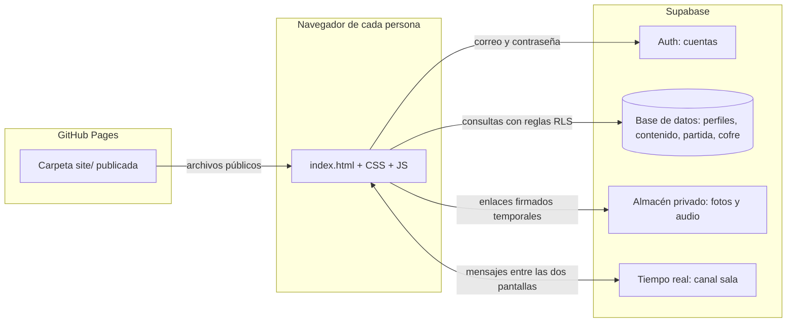
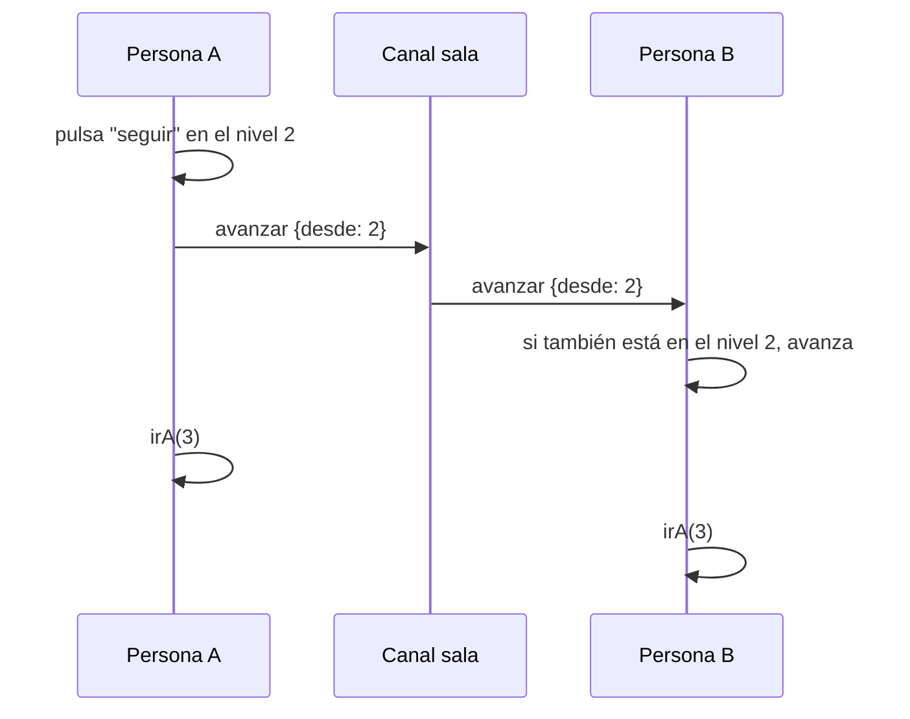

# Arquitectura

Este documento explica cómo está hecha la web: qué piezas hay, cómo se cargan, cómo se mantiene el contenido privado y cómo se sincronizan las dos pantallas. Está escrito para leerse sin conocimientos técnicos previos. Los términos técnicos aparecen explicados la primera vez que salen.

## Vista general

La web es una página estática: un único `index.html` y archivos de estilo y de código. Un navegador la descarga desde GitHub Pages (un servicio que publica archivos estáticos gratis). Para el acceso, los datos privados y la comunicación entre las dos personas, el navegador habla directamente con Supabase (un servicio en la nube con base de datos, cuentas de usuario, almacén de archivos y canales en tiempo real). No hay servidor propio.



Las flechas de datos entre el navegador y Supabase llevan siempre la sesión de la persona que ha entrado. Sin sesión válida, Supabase no devuelve nada privado.

## Piezas y responsabilidades

### Archivos de `site/js`

| Archivo | Qué hace |
|---|---|
| `config.js` | Guarda la dirección de Supabase y la clave pública (`anon`). Es el único archivo que hay que cambiar para usar otro proyecto. |
| `vendor/supabase.js` | Copia del cliente oficial de Supabase, servida desde el propio sitio. |
| `utiles.js` | Funciones comunes: normalizar texto (quitar tildes y mayúsculas para comparar), calcular un resumen SHA-256 y generar números aleatorios con semilla. |
| `radio.js` | Música de fondo desde un vídeo de YouTube. Solo arranca tras un clic. |
| `sonidos.js` | Efectos de sonido sintetizados en el navegador, sin archivos de audio. |
| `dialogo.js` | Diálogo por viñetas del piloto: cada clic avanza a la siguiente línea. |
| `main.js` | Gestor de niveles: orden de los niveles, cambios de pantalla, flores y arranque del juego. |
| `acceso.js` | Pantalla de inicio de sesión, comprobación de que la cuenta es una de las dos personas y cierre de sesión. |
| `contenido.js` | Lee los textos privados de la base de datos y pide enlaces temporales para las fotos y audios. |
| `sala.js` | Tiempo real: quién está conectado, el cursor de la otra persona y los mensajes entre pantallas. |
| `niveles/nivel0.js` a `nivel7.js` | La lógica de cada nivel. Cada archivo se registra solo en el gestor. |

### Otros archivos

| Archivo | Qué hace |
|---|---|
| `site/css/*.css` | Estilos. Cada nivel tiene su archivo y sus clases llevan un prefijo (`n2-`, `n4-`...) para que no choquen entre sí. |
| `supabase/schema.sql` | Crea las tablas, las reglas de acceso (RLS), las funciones del cofre y las reglas del canal `sala`. Se ejecuta una vez. |
| `supabase/sembrar.mjs` | Script que se ejecuta en el ordenador del autor. Crea las dos cuentas, sube los textos privados y las fotos. |
| `.github/workflows/pages.yml` | Publica la carpeta `site/` en GitHub Pages al subir cambios a `main`. |

## Cómo se carga el juego

Todos los archivos se cargan con etiquetas `<script>` normales, en un orden fijo, al final de `index.html`. No hay módulos (`import`/`export`) ni empaquetador: cada archivo se añade a `window`, que es el objeto global del navegador. Por ejemplo, `window.Juego`, `window.Sala` o `window.Contenido`.

El orden importa. `main.js` necesita que existan `Acceso` y `Sala`, y cada nivel necesita a `Juego` para registrarse.

Cada nivel termina con una llamada igual en todos los casos:

```js
window.Juego.registrar(N, { iniciar: iniciar, detener: detener });
```

`N` es el número del nivel. El nivel 0 añade además `ocultarHud: true`, para ocultar el rótulo del nivel hasta que empieza la acción.

## Ciclo de vida de un nivel

Un nivel tiene dos funciones obligatorias:

- `iniciar(seccion)`: se llama al entrar. Recibe la sección de la página donde dibuja el nivel. Crea los elementos, empieza los relojes y se suscribe a los mensajes.
- `detener()`: se llama al salir. Cancela todo lo que el nivel haya dejado en marcha.

Se llama a `detener()` antes de `iniciar()` del siguiente nivel. Así no quedan animaciones, relojes ni escuchas del nivel anterior activos. Cada nivel guarda sus relojes en una lista y `detener()` los cancela todos. Así se evita que un temporizador de un nivel ya cerrado cambie la pantalla actual.

Para que el nivel no reaccione a mensajes viejos, cada nivel lleva además un contador de sesión: si `detener()` ha corrido, cualquier respuesta tardía del servidor o del canal se descarta.

## Contenido privado

Los textos personales, las fotos y el audio no están en el repositorio. Se leen de Supabase así:

- `Contenido.cargar(cliente)` baja todas las filas de la tabla `contenido` (son pocas y pequeñas) tras iniciar sesión.
- `Contenido.obtener(clave, valorPorDefecto)` devuelve un valor ya cargado. Si la clave no existe, devuelve el valor por defecto. Por eso el juego funciona sin contenido: usa textos neutros de reserva.
- `Contenido.url(ruta)` pide un enlace firmado para un archivo del almacén privado. Ese enlace caduca a los 3600 segundos (una hora). Los enlaces se guardan en memoria mientras la pestaña está abierta.
- `Contenido.precargar(rutas)` pide varios enlaces a la vez para que las fotos estén listas.

Sin Supabase (modo local), `Contenido.url` devuelve una ruta local `assets/...`, por si hay archivos en la carpeta.

## Azar con semilla compartida

Algunos niveles necesitan un orden aleatorio (la baraja del memory, la forma del puzzle, la posición de los billetes). Si cada pantalla sorteara por su cuenta, las dos verían cosas distintas. La solución es una semilla: un número que las dos pantallas comparten.

- `Sala.semillaBase()` elige la semilla común. Es la del participante con el `id` más pequeño de los dos. Así las dos pantallas llegan a la misma semilla sin ponerse de acuerdo.
- `Juego.semilla(id)` deriva una semilla distinta para cada nivel a partir de la base, y la fija la primera vez que se pide.
- `Utiles.crearAzar(semilla)` crea un generador de números aleatorios (algoritmo mulberry32). La misma semilla produce siempre la misma secuencia.

Sin acompañante, la semilla base es un número aleatorio propio y el juego funciona igual.

## Tiempo real

Las dos pantallas se comunican por un canal privado de Supabase Realtime llamado `sala`. Un canal es como una sala de chat: los mensajes que envía uno solo los reciben los demás suscritos. Es privado porque las reglas de `schema.sql` solo dejan leer y escribir en `sala` a las dos cuentas autorizadas.

El canal lleva tres tipos de información:

| Tipo | Quién lo envía | Para qué |
|---|---|---|
| Presencia | Cada persona al conectarse | Saber quién está conectado. Muestra sus nombres y colores. |
| Cursor | `sala.js`, máximo 10 veces por segundo | Mostrar el puntero de la otra persona. Desaparece tras 4 segundos sin movimiento. |
| Mensajes `{t, d}` | Los niveles y `main.js` | `t` es el tipo de mensaje y `d` sus datos. Cada nivel escucha los tipos que le interesan. |

Un nivel emite con `Sala.emitir(tipo, datos)` y escucha con `Sala.alRecibir(tipo, fn)`. Esta última devuelve una función para dejar de escuchar.

### Entrada tardía

Si una persona entra cuando la otra ya está en un nivel, no puede saber en qué punto está el juego. Por eso el flujo es este:

1. La persona que entra emite `hola`.
2. La que ya está jugando responde con `estado`, con el nivel en el que está y las semillas.
3. La que entra arranca en ese nivel, con las flores que correspondan.

Si nadie responde en 1,5 segundos, la persona que entra empieza desde el nivel 0. Los niveles con partidas en curso usan sus propios mensajes `pide` y `estado` para afinar el punto exacto.

### Avanzar juntos

Pasar de nivel es cosa de las dos. Cuando una persona pulsa "seguir", `Juego.siguiente()` envía `avanzar` con el nivel desde el que se pide. La otra pantalla solo avanza si está en ese mismo nivel. Así se evitan los saltos dobles si los dos pulsan a la vez.



## Cómo se mantienen iguales dos pantallas

Hay dos estrategias, y cada nivel elige la que le conviene.

1. Mensajes de acción. Una pantalla envía lo que ha hecho ("he cogido la pieza 12", "he volteado la carta 4") y la otra lo reproduce. Es el caso de la mayoría de niveles.
2. Estado completo. Cuando alguien entra tarde, el que ya está jugando envía todo su estado (qué está hecho, de quién es el turno, qué posiciones hay). Así la otra pantalla no tiene que reconstruir el historial.

Hay dos reglas de desempate que aparecen en varios niveles:

- Quien tiene el turno, tiene el turno. En el memory solo puede voltear la persona a la que le toca.
- Si las dos personas hacen lo mismo a la vez, gana el `id` menor. En el puzzle, si las dos cogen la misma pieza, gana el `id` menor y la otra la devuelve a su sitio.

En el puzzle hay además un reloj lógico: cada suelta lleva un número de orden (un "sello"). Si dos sueltas de la misma pieza se cruzan por el camino, las dos pantallas se quedan con la de sello mayor. Así no hace falta que los relojes de los navegadores coincidan.

## Mensajes por nivel

Todos los mensajes van dentro del canal `sala` con la forma `{t, d}`. La columna "Quién espera" indica qué pantalla reacciona.

### Mensajes del gestor (`main.js`)

| Tipo | Datos | Qué hace al recibirse |
|---|---|---|
| `avanzar` | `{desde}` | Avanza al nivel siguiente si está en el nivel `desde`. |
| `hola` | `{}` | Responde con `estado` si hay un nivel activo. |
| `estado` | `{nivel, semillas}` | Arranca en el nivel indicado (solo si la persona acaba de entrar). |

### Mensajes por nivel

| Nivel | Tipo | Datos | Qué hace |
|---|---|---|---|
| 0 | (ninguno) | | Sin mensajes propios. Usa los del gestor. |
| 1 | `n1:pregunta` | `{indice, revelada, v}` | Muestra la pregunta indicada. |
| 1 | `n1:revela` | `{indice, v}` | Descubre la pregunta. |
| 1 | `n1:fin` | `{}` | Termina el recorrido de preguntas. |
| 1 | `n1:pide` | `{}` | Pide el estado a quien ya está. |
| 1 | `n1:estado` | `{indice, revelada, v, quiz, fin}` | Respuesta a `n1:pide`. |
| 2 | `n2:abre` | `{}` | Abre el álbum en las dos pantallas. |
| 2 | `n2:voltea` | `{i}` | Voltea la carta en la posición `i`. Solo lo envía quien tiene el turno. |
| 2 | `n2:turno` | `{id}` | Indica de quién es el turno tras un fallo. |
| 2 | `n2:pide` | `{nv}` | Quien entra tarde pide el estado. |
| 2 | `n2:estado` | Orden, cartas, hechas, turno, número de volteos, abierto | Respuesta a `n2:pide`. Gana quien lleva más volteos. |
| 3 | `n3:boton` | `{x, y, rot, n, r}` | Posición del botón "Nu" (normalizada a la ventana), que la otra pantalla persigue. |
| 3 | `n3:da` | `{r}` | Elige "Da" en la ronda `r`. |
| 4 | `n4:coge` | `{i}` | Se ha cogido la pieza `i`. |
| 4 | `n4:mueve` | `{i, x, y}` | La pieza `i` está en `(x, y)`. Como mucho unas 16 veces por segundo. |
| 4 | `n4:suelta` | `{i, x, y, v, colocada}` o `{i, cede: true}` | La pieza se ha soltado. `cede` indica que se pierde el desempate. |
| 4 | `n4:encaja` | `{i, ayuda}` | "Un ajutor" ha colocado la pieza `i`. |
| 4 | `n4:pide` | `{}` | Quien entra tarde pide el estado. |
| 4 | `n4:estado` | `{piezas}` | Respuesta a `n4:pide`. |
| 4 | `n4:latido` | `{n, mano}` | Cada 3 segundos: cuántas piezas tiene colocadas y cuál lleva en la mano. Corrige pérdidas de mensajes. |
| 5 | `n5:coche` | `{x, y, ang, v}` | Posición del coche. Lo envía quien conduce, como mucho 10 veces por segundo. |
| 5 | `n5:parada` | `{indice, x, y, ang}` | Se abre la parada `indice`. |
| 5 | `n5:cierra` | `{}` | Se cierra la ficha abierta. |
| 5 | `n5:aviso` | `{tipo}` | Aviso de parada no disponible (`cerrado`) o bloqueada (`bloqueada`). |
| 5 | `n5:cifras` | `{x, y, ang}` | Se abre la garita de la frontera y se muestran sus cifras. |
| 5 | `n5:cruza` | `{}` | El coche cruza la barrera. |
| 5 | `n5:continua` | `{}` | Pasa al final del nivel. |
| 5 | `n5:intro` | `{}` | Termina el diálogo inicial. |
| 5 | `n5:pide` / `n5:estado` | `{}` / estado completo | Entrada tardía. |
| 6 | `n6:trazo` | `{tanda, tarjeta, x, y, ini?, fin?}` | Trazo de rascado en un billete. Como mucho 20 veces por segundo, con uno final al soltar. |
| 6 | `n6:revela` | `{tanda, tarjeta}` | El billete se da por descubierto. |
| 6 | `n6:intro` | `{}` | Termina el diálogo inicial. |
| 6 | `n6:continua` | `{}` | Pasa al final del nivel. |
| 6 | `n6:pide` / `n6:estado` | `{}` / estado completo | Entrada tardía. |
| 7 | `n7:cifra` | `{pos, valor}` | Cambia una rueda del cofre. Se comparte la posición. |
| 7 | `n7:fallo` | `{i}` | Un intento fallido. |
| 7 | `n7:abierto` | `{}` | El cofre se ha abierto. La otra pantalla pide la carta. |
| 7 | `n7:leer` | `{}` | Arrancan a la vez los farolillos y la carta. |
| 7 | `n7:pide` / `n7:estado` | `{}` / `{cifras, abierto}` | Entrada tardía. |

El nivel 7 comprueba el código de cuatro cifras en el servidor, con la función `abrir_cofre`. La carta se pide con `leer_carta` desde la otra pantalla. Ver [SEGURIDAD.md](SEGURIDAD.md).
